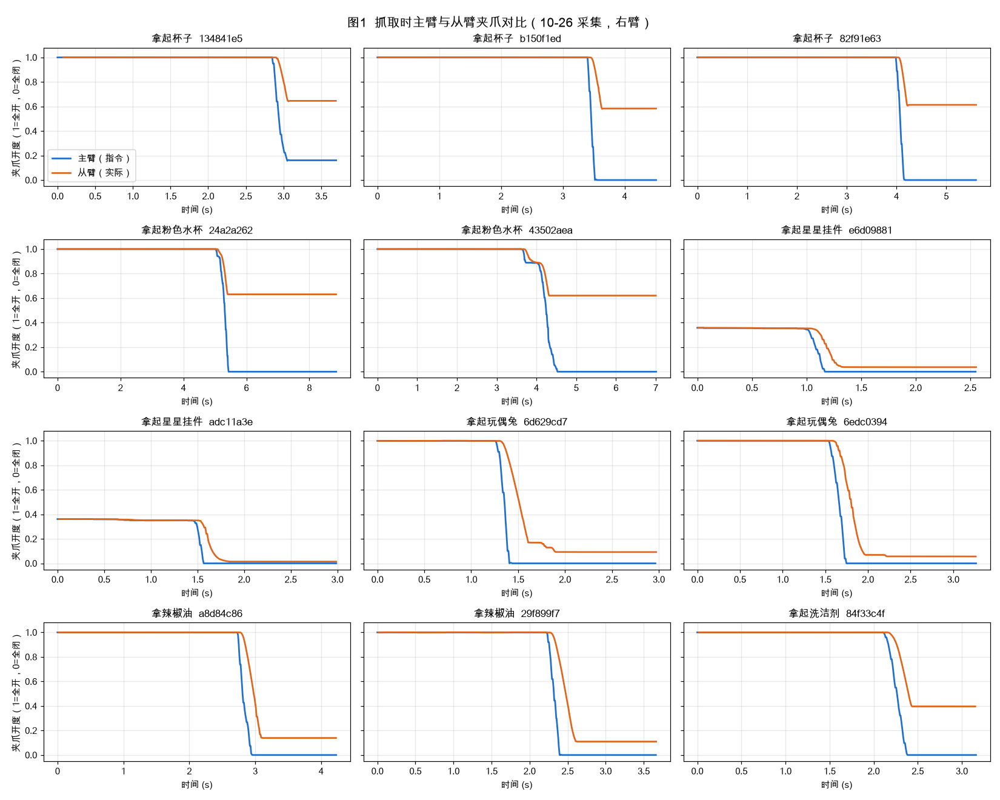
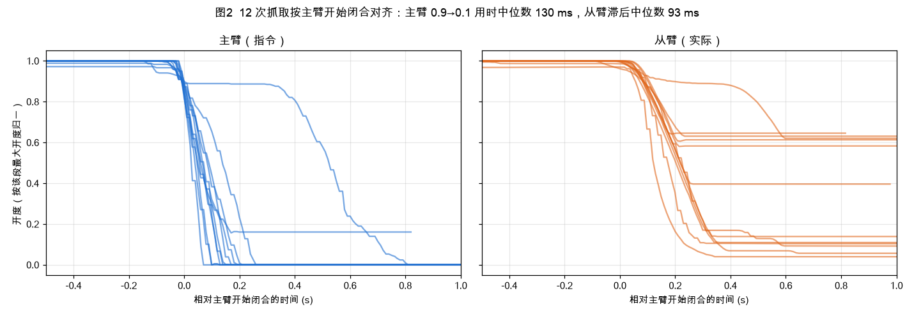
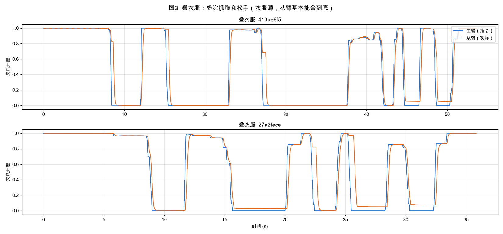
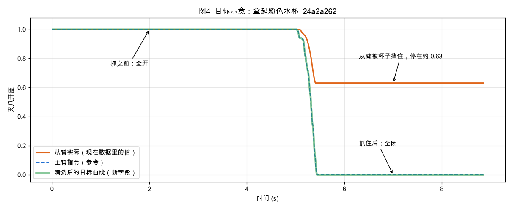

# 

# 背景

PushCart（小推车）用遥操作采集数据：操作员握着主臂，机械臂（从臂）跟着动，同时录下相机画面和关节数据。这些数据用来训练机器人策略模型。

目前训练数据里的夹爪值，是从臂夹爪实际张开的宽度，换算成 0\~1（1 = 全开，0 = 全闭）。这样有两个问题：

- **夹到东西后合不拢**：从臂被物体挡住，数值停在物体的宽度上，不会到 0。例如拿杯子时停在 0\.6 左右。

- **抓之前会乱晃**：操作员手抖，夹爪常常半开半合。

主臂（操作员手上的指令）没有这个问题：抓的时候直接合到 0，见下图。

# 主臂夹爪长什么样

下面两张图把主臂的动作看得更细，设计过渡段时参考。

# 目标

根据从臂夹爪的数据，生成一条干净的夹爪曲线：

- 抓之前保持张开，抓住之后保持全闭。

- 中间的闭合过程，参照主臂夹爪的真实动作补一段平滑过渡。

- 松手时反过来：从全闭平滑过渡到张开。

- 整段都没有抓取的 episode 保持原样。

清洗后的值作为**新字段**写入数据，原有的字段一律不改。

# 目录（都在 h100 服务器上）

## 要处理的三个发布版

位于 `/gpfs/jiuquyun/datasets/PRETRAIN_DATA/` 下：

- `PushCart-CollectSite-20261029-priority-en-flu-tool-v6-idletrim1-accepted-durclean`

- `PushCart-CollectSite-20261029-remaining-en-flu-tool-v6-idletrim1-accepted-durclean`

- `PushCart-CollectSite-scope139-20261026-b39c35c5-remaining-en-flu-tool-v4-idletrim3-drawer-accepted-durclean`

当前夹爪值的位置：每个发布版下各子目录 `data/` 里 parquet 文件的 `observation.state` 第 19 维（从 0 数起），取值 0\~1。

## 有主臂夹爪的原始数据（做参考用）

- **首选**：`/gpfs/jiuquyun/datasets/ks3-raw/discover/PushCart-CollectSite/20261023-20261028/<任务>/2026-10-26/` 下的 `recording_*.mcap`。这批是真实抓取任务（拿起杯子、拿辣椒油、拿起星星挂件等，约 1,700 段），同时录了主臂指令 `/arm/right/gripper/joint_command` 和从臂实际 `/arm/right/gripper/joint_state`。图1 和图2 都来自这批数据。

- 叠衣服数据：同一目录下的 `叠衣服/`，适合参考多次抓放和松手。

- 更早的主臂调研：`/gpfs/jiuquyun/projects/yiyang/pushcart-leader-survey-20261027/`。

## 代码与工作目录

- 画上面这些图的脚本：`/gpfs/jiuquyun/projects/yiyang/pushcart-gripper-figs-20261102/`，其中 `extract.py` 负责读 mcap，`plot.py` 负责画图。可以直接拿来改。

- 处理代码：orion\-data\-pipeline 仓库的 `src/orion_pipeline/robot/pushcart/`。

- 本任务的工作目录：`/gpfs/jiuquyun/projects/yiyang/pushcart-gripper-cmd-20261030/`。

# 要做的事

1. **看主臂**：从有主臂夹爪的数据里统计主臂开合的速度和曲线形状，作为过渡段的模板。

2. **找时刻**：在从臂夹爪曲线上找出每次抓取和松手的时刻。

3. **生成新曲线**：按目标生成新曲线，参数集中写在一个配置文件里。

4. **检查效果**：在有主臂数据的 episode 上，只用从臂生成曲线，再和真实主臂对比；另外抽一批 episode 画图，人工看一遍。

5. **生成新版本**：每个发布版都派生一份 `<原目录名>-gripcmd`，加上新字段，并确认训练程序能正常读取。发布前先确认。

# 规则

- 原有的发布数据和原始数据都只读。

- 处理时要打印提示，并记录每个任务改了多少条。

